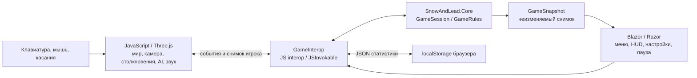
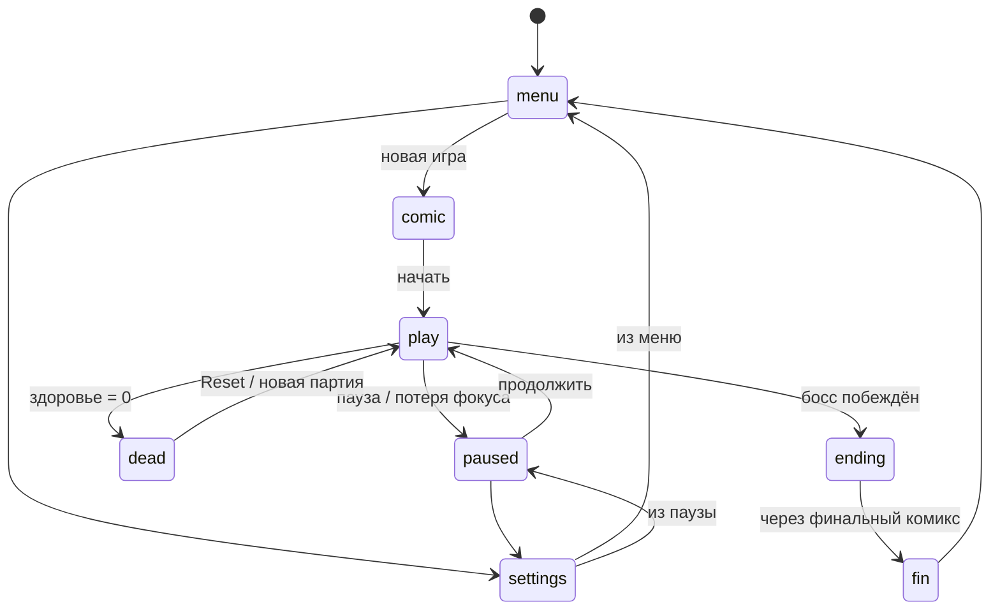

# Архитектура Snow & Lead — Night Debt

**Автор: заполнить перед сдачей.** Платформа: standalone Blazor WebAssembly, .NET 10, C#, Razor и Three.js r128. Приложение работает в браузере; сервер при локальном запуске раздаёт статические файлы. Встроенного серверного API нет.

## Компоненты и границы

| Часть | Ответственность |
|---|---|
| `SnowAndLead.Core` | Детерминированные правила: разрешение выстрела, расход патронов, перезарядка, здоровье, энергия замедления, сложность, очки, миссия, статистика. Не обращается к DOM, WebGL, часам или хранилищу браузера. |
| `GameSession` | Контейнер состояния текущей партии. Принимает команды и события мира; возвращает новый снимок. Сохраняет рекорды при перезапуске партии. |
| `GameSnapshot` | C# `record` с `init`-свойствами. Доступ к данным без возможности изменить опубликованный снимок. Изменения создают новый экземпляр через `with`. |
| `GameRules` | Именованные константы и чистые вычисления, например урон обычного попадания и попадания в голову. Чистая функция возвращает результат из аргументов без внешних эффектов. |
| `Client.Services.GameInterop` | Связывает C# и JavaScript, предоставляет методы с `[JSInvokable]`, передаёт команды UI, координирует обновления UI и хранение статистики. |
| Razor-компоненты | Отображают состояние и сообщают о намерении пользователя через параметры и обработчики событий. Меню, HUD, настройки и пауза отделены от правил боя. |
| JavaScript / Three.js | Рендеринг и анимация, геометрия, перемещение, столкновения, AI противников, определение попадания лучом, камера, быстрый ввод, звук. Сообщает в C# о событиях мира. |

В `Client/Components/` используются `GameRoot`, `MainMenu`, `PauseScreen`, `SettingsScreen`, `EndScreen`, `TouchControls` и `GameHud`. Общие `GameButton` и `HudMeter` принимают параметры. `PlayerVitals`, `AmmoReadout`, `MissionReadout` и `SessionSummary` отображают части снимка; общий `LiveGameComponent` управляет подпиской на изменения. `GameSettings` проверяет значения настроек. Canvas, мини-карта и комикс остаются постоянными DOM-узлами, которыми управляет JavaScript.

Разделение проходит по цене вычислений и ответственности. C# решает, можно ли выстрелить и как изменятся игровые ресурсы. JavaScript определяет, во что попал луч в трёхмерной сцене. `iframe` для запуска прежней игры не используется: браузерная сцена интегрирована в Blazor через JS interop.

## Поток данных

1. Игрок нажимает FIRE / Mouse1. Быстрый ввод в JavaScript формирует запрос на выстрел.
2. Вызов проходит через `GameInterop` к `GameSession.Shoot()`. Ядро проверяет фазу игры, таймер выстрела, патроны и перезарядку.
3. Если выстрел разрешён, сцена воспроизводит эффект и определяет попадание. Уничтожение противника передаётся в `RegisterKill(...)`; один ID не может начислить очки повторно.
4. C# возвращает актуальный снимок ресурсов. JavaScript использует его для текущего кадра; Blazor обновляет текстовые показатели с ограничением частоты.

Состояние игрока синхронизируется раз за игровой кадр и при отдельных действиях. Уведомления Razor UI ограничены примерно 10 Гц: рендеринг сцены не требует перерисовывать HTML-интерфейс на каждом кадре. Ядро принимает `dt` явно; `Tick(dt)` ограничивает слишком большой шаг и не двигает таймеры вне фазы `play`. Это позволяет воспроизводить правила в модульных тестах без настоящих часов и браузера.

## Фазы и пауза

Это схема пользовательского сценария; `GameSession.SetPhase()` дополнительно проверяет допустимые имена фаз и запрещает продолжать завершённую партию без `Reset()`. Ошибка загрузки или WebGL приводит к отдельному состоянию `error` с понятным сообщением. При паузе нужно останавливать симуляцию и сбрасывать активный ввод; одного визуального перекрытия сцены недостаточно.

## Данные и устойчивость

Доступная JavaScript граница `GameInterop`: `Reset`, `SetPhase`, `Tick`, `Shoot`, `Reload`, `SetSlow`, `Hurt`, `Pickup`, `RegisterKill`, `ReportPosition`, `ShotDamage`, `ExportProgress`, `ImportProgress`. Методы передают действия в ядро; интерфейс обращается к браузерным командам сцены через `SnowGame`. Эти методы являются внутренним контрактом приложения, а не сетевым API.

`ExportProgress()` выдаёт версионированный JSON со значениями `bestScore`, `deaths`, `victories`. `ImportProgress()` проверяет формат и границы чисел; повреждённый или неподдерживаемый JSON отклоняется. Рекорды объединяются без уменьшения уже известных значений. Позиция игрока, мир, враги, текущее здоровье и патроны не являются сохранением уровня.

`localStorage` находится на устройстве пользователя и привязан к origin. Другой браузер, другой адрес/порт или очистка данных могут дать отдельную статистику. При недоступном хранилище игра должна сохранять возможность играть в текущем сеансе. Это локальные данные без аккаунта и облачной синхронизации; защита от редактирования статистики пользователем не заявляется.

## Проверяемость и развитие

Тестовый проект `tests/SnowAndLead.Core.Tests` использует xUnit. Приоритетные сценарии: запрет команд вне игры, таймеры и пауза, расход ресурсов, недопустимые значения, повторные события убийства, сложность, смерть/победа, восстановление статистики. Браузерные проверки отдельно нужны для JS interop, ввода, камеры, размеров экрана и жизненного цикла. Фактические результаты находятся в итоговом отчёте проверок.

Для нового оружия правила добавляются в Core, отображение — в Razor, модель и эффекты — в сцену. Для облачных рекордов потребуется сервер и отдельная проверка доверия к событиям клиента. Такая возможность развития не является доказательством серверной масштабируемости. Текущая архитектура модульная, но весь проект не является чисто функциональным: `GameSession` хранит изменяемое состояние, а JavaScript содержит побочные эффекты браузера и сцены.
